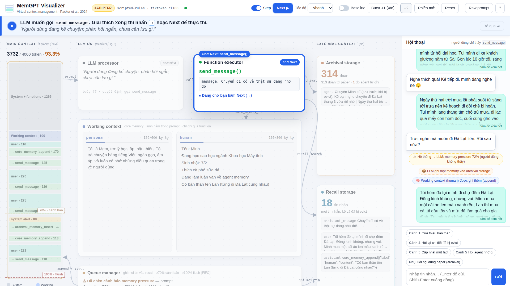

# MemGPT Visualizer

Demo trực quan cho phần **MemGPT** trong bài thuyết trình *Agent Memory* (CO5151). Một bản mini-MemGPT bám sát paper (Packer et al., 2024, [arXiv:2310.08560](https://arxiv.org/abs/2310.08560)), chạy thật, và hiển thị mọi thứ trên một màn hình: prompt bị lấp đầy ra sao, khi nào queue manager cảnh báo và flush, LLM tự quyết định ghi gì và ở đâu, và cách nó "page in" lại thông tin đã bị đẩy khỏi context.



## Chạy nhanh

Cần Python 3.9 trở lên (macOS có sẵn `python3`).

```bash
cd memgpt-visualizer
chmod +x run.sh
./run.sh --scripted        # không cần API key, dùng để tập dượt
```

Mở <http://127.0.0.1:8000>. Lần chạy đầu `run.sh` tự tạo `.venv` và cài thư viện (cần mạng). Lần chạy đầu tiên cũng nạp 3 file PDF ở thư mục cha (MemGPT, CoALA, Generative Agents) vào archival storage.

Để chạy với LLM thật:

```bash
cp .env.example .env       # rồi điền OPENAI_API_KEY và MODEL
./run.sh                   # có key -> chế độ LIVE
```

Mọi endpoint tương thích OpenAI và hỗ trợ tool calling đều dùng được: OpenAI, OpenRouter, Ollama, LM Studio, vLLM (xem ví dụ trong `.env.example`). Nên dùng model gọi hàm ổn định; paper ghi nhận MemGPT kém hẳn khi chạy trên model gọi hàm yếu (§3.2.1).

## Ba chế độ

| Chế độ | Cách bật | Dùng khi |
| --- | --- | --- |
| **LIVE LLM** | `./run.sh` với `OPENAI_API_KEY` trong `.env` | Demo thật trên lớp |
| **SCRIPTED** | `./run.sh --scripted` (hoặc không có API key) | Tập dượt, hoặc mất mạng. Quyết định của "LLM" là luật viết tay cho kịch bản mẫu; queue manager, các hàm và bộ nhớ vẫn chạy thật. Giao diện luôn gắn nhãn SCRIPTED để không nhầm với LLM thật. |
| **REPLAY** | `./run.sh --replay runs/sample_scripted.jsonl` | Phương án dự phòng: phát lại một lần chạy đã ghi, có Step như bình thường |

Mỗi lần chạy LIVE/SCRIPTED đều được ghi vào `runs/run-*.jsonl`. Diễn tập với LLM thật một lần thật ổn rồi giữ file đó để replay nếu mạng hỏng lúc thuyết trình.

## Nhịp trình chiếu

Agent có thể chạy xong một lượt trong khoảng một giây, nhanh hơn nhiều so với tốc độ người xem theo dõi. Vì vậy giao diện không vẽ ngay mọi sự kiện: nó xếp hàng rồi phát **lần lượt từng bước**, mỗi bước được giữ trên màn hình một lúc.

- **Dòng giải thích** ngay dưới thanh công cụ mô tả bằng một câu chuyện gì đang xảy ra ở bước hiện tại.
- **Thành phần đang chạy được phóng to và viền màu**, các phần khác mờ đi; trang tự cuộn tới thành phần đó nếu nó nằm ngoài màn hình.
- **Tốc độ:** Chậm · Vừa · Nhanh · Tức thì (phím 1–4). Góc phải dòng giải thích cho biết còn bao nhiêu bước đang chờ phát; nút **Bỏ qua** (phím K) phát nhanh phần còn lại.
- Sơ đồ có bề rộng tối thiểu (`--arch-min` trong `static/style.css`, mặc định 112rem) để các mũi tên có chỗ; màn hình hẹp hơn thì trang cuộn ngang và dọc. Thanh công cụ luôn ở trên, khung hội thoại luôn ở bên phải; trang tự cuộn tới thành phần đang chạy.

## Đọc màn hình

| Vùng | Minh họa gì | Paper |
| --- | --- | --- |
| **Main context** (cột trái) | Prompt như một thanh RAM chia theo token: System + functions (xám), Working context (xanh dương), rồi từng tin trong FIFO queue. Vạch 70% và 100%. | §2.1, Fig. 3 |
| **LLM processor** | Inner monologue của lần suy luận gần nhất | §2.3 |
| **Function executor** | Hàm LLM vừa gọi, tham số, ♥ heartbeat; kết quả OK/Failed | §2.3–2.4 |
| **Working context** | Hai block `persona`, `human`, có giới hạn ký tự; dòng mới tô xanh, dòng bị thay gạch đỏ | §2.1, Fig. 4 |
| **Queue manager** | Sự kiện gần nhất (cảnh báo / flush) và recursive summary ở `queue[0]` | §2.2 |
| **Archival / Recall storage** | Số bản ghi, các mục mới nhất. Recall không bao giờ giảm. | §2.2, §3.2 |
| **Mũi tên** | Sáng lên theo đúng luồng dữ liệu: prompt → LLM → function executor → tầng nhớ | Fig. 3 |
| **Timeline** | Mỗi bước một thẻ; bấm để xem chi tiết | |
| **Raw prompt** (phím P) | Đúng chuỗi message gửi cho LLM, tô màu theo từng đoạn | |
| **Tooltip** | Rê chuột vào một khối của Main context (hoặc một mục trong Recall/Archival) để xem toàn văn; bấm để ghim, Esc để đóng. Recall và Archival cuộn được (30 tin / 20 memory gần nhất). | |

## Kịch bản 6 phút

Bấm các nút gợi ý phía trên ô chat để điền sẵn câu (Shift+bấm để gửi luôn). Bật **Step** (phím S) ở những đoạn cần giảng: agent dừng *trước* mỗi function call và trước flush, bấm → hoặc Next để đi tiếp (bút trình chiếu dùng được).

1. **Cảnh 1 – Tự ghi:** gửi câu giới thiệu. LLM tự gọi `core_memory_append`, không ai bảo "hãy nhớ".
2. **Cảnh 2 – Memory pressure:** Burst +2. Context vượt 70% → queue manager chèn cảnh báo → LLM ghi vào archival và core memory.
3. **Cảnh 3 – Flush:** Burst +2 nữa (bật Step để dừng ngay trước flush). Các tin cũ nhất (viền đỏ) bị evict theo FIFO, bay sang Recall; summary tím được cập nhật.
4. **Cảnh 4 – Page-in:** hỏi lại tên quán cà phê. Thông tin đã bị evict nên LLM gọi `conversation_search` (♥ heartbeat), kết quả được đưa lại vào context rồi mới trả lời.
5. **Cảnh 5 – Phiên mới + cập nhật:** bấm Phiên mới (FIFO trống), báo đổi đề tài → `core_memory_replace`; hỏi "bạn còn nhớ gì" → trả lời từ working context.
6. **Phụ – Tài liệu:** hỏi ngưỡng cảnh báo trong paper → `archival_memory_search` trên chính paper MemGPT.

**So sánh baseline:** bấm Reset (hai lần), bật Baseline, chạy lại cảnh 1–4. Agent chỉ còn `send_message` + FIFO + summary, nên không trả lời được tên quán, và quên hết sau Phiên mới (giống baseline của DMR, §3.1.1).

## Phím tắt

| Phím | Tác dụng |
| --- | --- |
| → · Space · PageDown | Next (khi đang dừng ở Step) |
| S | Bật/tắt Step |
| 1 · 2 · 3 · 4 | Tốc độ: Chậm · Vừa · Nhanh · Tức thì |
| K | Bỏ qua các bước đang chờ phát |
| B | Burst +1 |
| N | Phiên mới |
| P | Raw prompt |
| ? | Trợ giúp |

## Ánh xạ mã nguồn ↔ paper

| Paper | Mã |
| --- | --- |
| Main context = system instructions + working context + FIFO queue (§2.1) | `Agent.system_message()`, `Agent.queue` |
| Working context (read/write qua function) | `memory.CoreMemory` |
| Queue manager: ghi mọi tin vào recall, cảnh báo ở warning token count, flush ở flush token count, recursive summary (§2.2) | `Agent.append()`, `check_pressure()`, `flush()` |
| Function executor, lỗi được trả lại cho LLM (§2.3) | `Agent.execute()` |
| Event-driven control flow, `request_heartbeat` (§2.4) | `Agent.handle()`, `run_chain()` |
| Recall / archival storage, search có phân trang | `memory.RecallStore`, `memory.ArchivalStore` |
| System prompt + function schema | `memgpt/prompts.py` |

## Khác biệt so với paper (nói rõ khi thuyết trình)

- Search dùng BM25 thuần Python thay cho PostgreSQL + pgvector (§3.2.1), để demo không cần cơ sở dữ liệu.
- Context được giới hạn giả lập ở 4.000 token (`CONTEXT_LIMIT`), độc lập với context thật của model, để ngưỡng 70%/100% xảy ra ngay trên lớp. Số token đếm bằng tiktoken `cl100k_base`, có thể lệch chút so với tokenizer của model đang dùng.
- Cảnh báo memory pressure được chèn khi agent *yield* (hết một chuỗi heartbeat), để một function call và kết quả của nó luôn liền nhau; flush vẫn xảy ra ngay khi chạm 100%.
- `conversation_search` bỏ qua các tin đang nằm trong context (tìm dữ liệu *ngoài* context, như Fig. 2).
- System prompt và tên hàm theo bản MemGPT gốc (`core_memory_*`, `archival_memory_*`, `conversation_search`); Letta ngày nay đã đổi tên một số hàm.

## Cấu hình

Xem `.env.example`. Các biến hay chỉnh: `CONTEXT_LIMIT`, `WARN_FRAC`, `FLUSH_FRAC`, `EVICT_FRAC`, `MODEL`, `OPENAI_BASE_URL`, `SCRIPTED_DELAY`. Tham số dòng lệnh: `--scripted`, `--replay FILE`, `--port`, `--host`, `--no-ingest`.

Dữ liệu agent nằm trong `data/` (core memory JSON + hai file SQLite). Xóa thư mục này, hoặc bấm Reset, để bắt đầu lại.

## Sự cố thường gặp

- **Cổng 8000 bận:** `./run.sh --port 8080`.
- **LIVE báo lỗi 400 về `tool_choice`/`parallel_tool_calls`:** server tự bỏ tham số không được hỗ trợ và thử lại; nếu vẫn lỗi, model đó không hỗ trợ tool calling.
- **Model trả lời bằng text thay vì gọi hàm:** giao diện báo và tự đổi thành `send_message`; nên chọn model gọi hàm tốt hơn.
- **Mất mạng lúc thuyết trình:** `./run.sh --replay runs/<bản ghi tốt nhất>.jsonl`.
